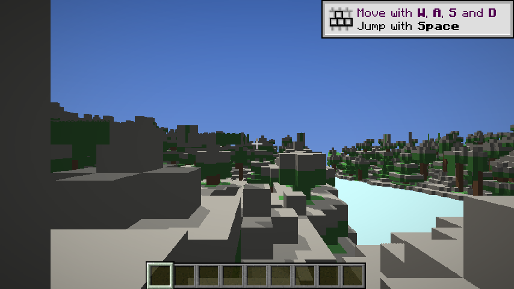
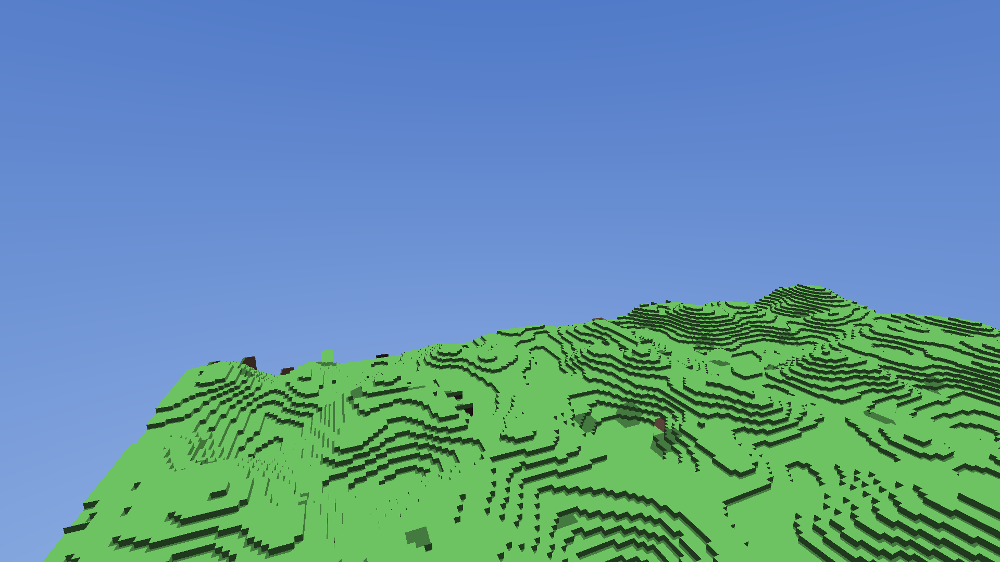

# BrickTrace

Open-source hardware ray tracing for **Minecraft Java Edition 26.3**.

**Static brick BVH + dynamic voxel payload** — the RT cores traverse a BLAS of 4³ brick AABBs, an intersection shader runs voxel DDA inside each brick, and block changes only rewrite voxel data. No acceleration structure is rebuilt when the world changes.





> Status: **0.2.0 prototype**. The native Vulkan ray tracer runs on **Minecraft's own VkDevice**, streams the loaded client chunks into brick voxel data, follows the player camera and presents the ray traced frame in-game as a full screen layer. Block edits do not update the world yet (one snapshot per join), and materials use a small palette instead of textures.

## Why

Existing Minecraft RT mods (Radiance, Radiante) trace triangle BLAS built from block geometry, so editing a block means rebuilding or refitting the affected acceleration structures. BrickTrace keeps the acceleration structure static: a 16³ section is 64 bricks of 4³ voxels, each brick is one AABB primitive with a 64-bit occupancy mask, and the voxel payload lives in a plain buffer that can be updated in microseconds.

## Architecture

```
Minecraft 26.3 JVM
├─ Fabric Mixin (LevelRenderer / GameRenderer)
├─ WorldSnapshot (chunk / block / light / entity / camera)
├─ double-buffered snapshot + dirty-section queue
└─ JNI
    └─ Native C++ renderer (Vulkan 1.3, KHR ray tracing)
        ├─ WorldDB      brick pool / material table
        ├─ ASManager    static BLAS per section + per-frame TLAS
        ├─ RT passes    primary + shadow (reflection / GI planned)
        ├─ Denoise      NRD, DLSS RR (planned)
        └─ Composite / Present (planned)
```

| Layer | Representation |
|---|---|
| Section | 16³ blocks, 64 bricks |
| Brick | 4³ voxels, `uint64` occupancy mask |
| Voxel | `uint32`: material 16b · block light 4b · sky light 4b · flags 8b |
| BLAS | one AABB primitive per non-empty brick, built once per section |
| TLAS | visible sections, identity transform, rebuilt per frame |

## Results (RTX 5060 Laptop, driver 621.01)

256×128×256 demo world, 947 non-empty sections, 50,217 bricks, 1920×1080:

| Metric | Value |
|---|---|
| GPU trace rays (primary + shadow) | **0.96 ms/frame** (≈1045 fps) |
| Section upload + BLAS/TLAS build | 203 ms (one-off) |
| BLAS + TLAS memory | 3.5 MiB |
| Device | NVIDIA GeForce RTX 5060 Laptop GPU, 7.7 GiB |

Measured with `bricktrace-rtbench` (timestamp queries around `vkCmdTraceRaysKHR`). Wall-clock per frame in the benchmark includes a blocking readback to PNG and is therefore not representative.

## Install

Requirements:

- Minecraft **26.3** with **Fabric Loader 0.20.1+** and **Fabric API 0.165.2+26.3**
- Windows x64, NVIDIA RTX (tested on RTX 5060), Vulkan 1.3 with ray tracing extensions
- Java 25

Drop `bricktrace-0.1.0.jar` into `.minecraft/mods`, start the game. The mod extracts its native library and SPIR-V shaders to `.minecraft/config/bricktrace/natives`, enumerates the Vulkan device on startup, and logs it:

```
BrickTrace native device info:
NVIDIA GeForce RTX 5060 Laptop GPU api=1.4.357 AS=1 RT=1 RQ=1 vram=7.7GiB
```

After joining a world it renders one offscreen RT frame to `.minecraft/bricktrace_test_frame.png`.

## Build

Native (C++20, CMake + MSVC + Vulkan SDK):

```powershell
cmake -S native -B native/build -G "Visual Studio 18 2026" -A x64
cmake --build native/build --config RelWithDebInfo

# offline renderer: writes bricktrace_frame.png and prints timings
.\native\build\RelWithDebInfo\bricktrace-rtbench.exe --shaders native\build\shaders --out native\build `
    --frames 120 --width 1920 --height 1080 --cam 128 96 40 --pitch -0.22
```

Mod (Java 25, Gradle 9.8.2, Loom 1.19):

```powershell
cd mod
.\gradlew.bat build        # -> mod/build/libs/bricktrace-0.1.0.jar
.\gradlew.bat runClient    # dev client, no launcher account needed
```

The jar build copies `native/build/RelWithDebInfo/bricktrace_jni.dll` and the compiled shaders into the jar, so build the native side first.

## Repository layout

```
mod/        Fabric mod (Java 25, Loom)
native/     C++20 Vulkan renderer, JNI bridge, tools
shaders/    GLSL ray tracing shaders, compiled by CMake via glslang
docs/       architecture, roadmap, environment, prior art, M1 report
scripts/    environment check
```

## Docs

- [docs/architecture.md](docs/architecture.md) — technical design
- [docs/roadmap.md](docs/roadmap.md) — phases and the 14-day M1 plan
- [docs/environment.md](docs/environment.md) — Windows toolchain setup
- [docs/prior-art.md](docs/prior-art.md) — prior art and novelty claim
- [docs/report-01.md](docs/report-01.md) — M1 results

## License

[GPL-3.0](LICENSE). Third-party components keep their own licenses.

This project is clean-room: it is not derived from any closed-source Minecraft ray tracing mod, and no such code or assets are included.
